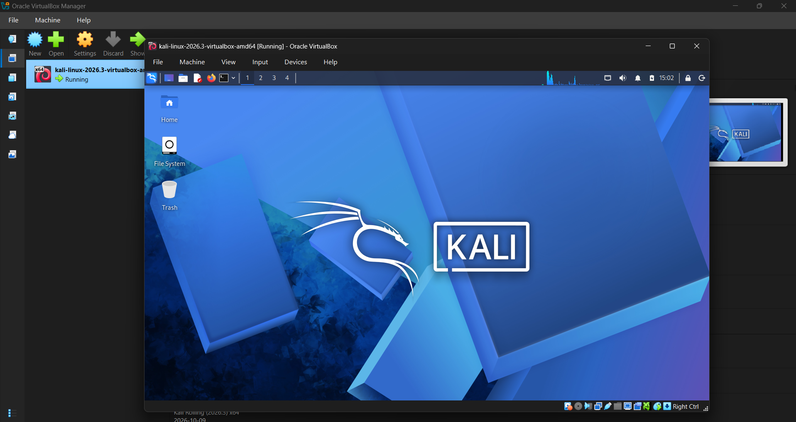
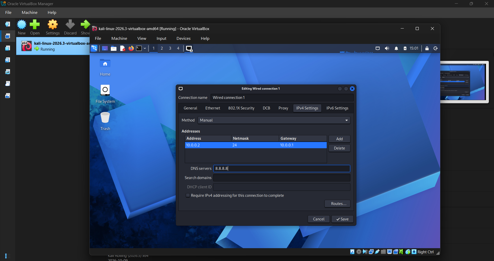
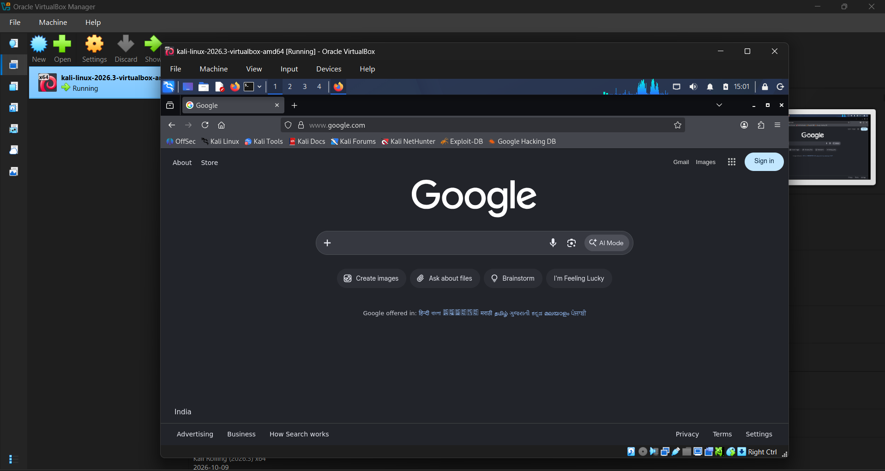
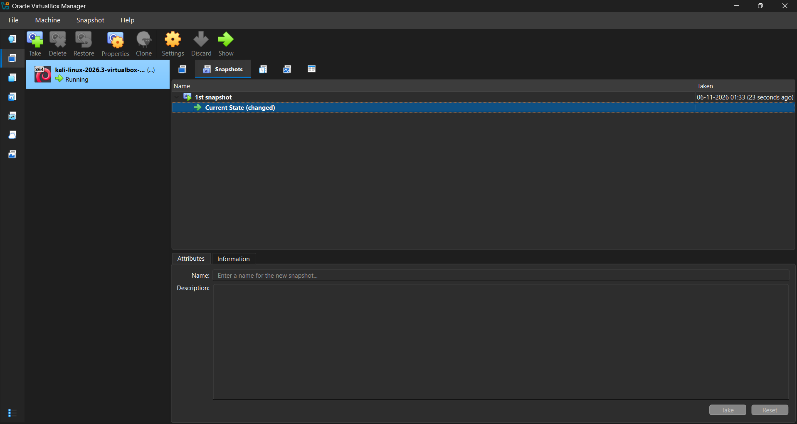

# NETWORKWALKS-DARSH-B084A-WK1-PM1-CYBERSECURITY-LAB-SETUP

# Week 1: Cybersecurity Lab Setup – Kali Linux VM

**NetworkWalks Cybersecurity Internship**

## 1. Project Overview

This project focuses on setting up a virtual cybersecurity lab environment using Kali Linux and Oracle VM VirtualBox.

The objective was to install and configure Kali Linux, establish network connectivity, and create a virtual machine snapshot to preserve the configured environment for future cybersecurity exercises.

## 2. Tools & Technologies

- **Kali Linux:** Linux distribution used for cybersecurity and penetration testing.
- **Oracle VM VirtualBox:** Virtualization platform used to run Kali Linux.
- **NAT Network:** Virtual networking configuration used to provide network connectivity to the VM.

## 3. Lab Environment Setup

The following tasks were completed:

- Set up a Kali Linux virtual machine in VirtualBox.
- Configured the virtual machine's system resources.
- Successfully booted into the Kali Linux desktop.
- Configured the VM's network adapter using NAT Network.

## 4. Network Configuration

Configured the virtual machine to use a NAT Network through VirtualBox.

This configuration allows the virtual machine to access external networks while operating within a virtualized network environment.

The network configuration was checked through VirtualBox's network settings.

## 5. Connectivity Verification

Internet connectivity was verified by:

- Opening the web browser inside Kali Linux.
- Accessing Google successfully.
- Confirming that external websites could be reached from the virtual machine.

This confirmed basic internet access from the Kali Linux environment.

## 6. Virtual Machine Snapshot

Created a VM snapshot after completing the initial configuration.

The snapshot provides a restore point that can be used to return the virtual machine to its configured state if future experiments cause unwanted changes.

## 7. Screenshots & Evidence

### Kali Linux Desktop

### Network Configuration

### Connectivity Verification

### Virtual Machine Snapshot

## 8. Key Learning Outcomes

Through this project, I gained practical experience with:

- Setting up and managing virtual machines.
- Understanding the Kali Linux environment.
- Configuring NAT Network in VirtualBox.
- Verifying basic internet connectivity.
- Understanding the purpose of virtual machine snapshots and recovery points.

## 9. Conclusion

Successfully completed the initial cybersecurity lab setup by installing Kali Linux, configuring NAT networking, verifying internet connectivity, and creating a VM snapshot.

This lab environment will serve as the foundation for upcoming hands-on cybersecurity projects.

---

**Internship:** NetworkWalks
**Domain:** Cybersecurity
**Project:** Week 1 – Kali Linux VM Setup

- Introduction to cybersecurity lab environments.

## Conclusion
Successfully configured a Kali Linux virtual
machine for future cybersecurity exercises.
